# Companion Radio — Display & Button Guide

How to use the display and button on your Companion Radio node. Applies to all supported hardware — OLED (Heltec V3, V4, and the optional 0.96" SSD1306 / 1.3" SH1106 OLED on HT-CT62, XIAO ESP32S3 & Wio-SX1262 Kit and Waveshare ESP32-S3-LR1121-XF), color TFT (Heltec T096), and e-ink (Heltec E213, Wireless Paper, E290).

---

## Button basics

One button does everything:

| Press | Action |
|---|---|
| **Single click** | Next page / next item / scroll down |
| **Double click** | Previous page / back |
| **Triple click** | Previous item; where there is none, the same as double click |
| **Long press** | Open / select: the page's list or menu, the selected item |

> **Heltec E213 and E290 — second button (GPIO21):** works like a triple click. The Wireless Paper has only one button.

---

## Home screen pages

Single click cycles forward; double click and triple click both cycle backward.

| Page | What it shows |
|---|---|
| **Home** | Current time (large), date, connection status, battery |
| **Chats** | Most recent conversations |
| **Quick Send** | Send a preset message over LoRa |
| **Contacts** | List of known contacts for direct messaging |
| **Saved Locations** | Preview of saved map locations |
| **Recent** | Most recently heard nodes over LoRa, or found via Node Discovery |
| **Radio** | LoRa radio parameters and noise floor |
| **GPS** | GPS status and coordinates *(if GPS hardware present)* |
| **Sensors** | Battery history chart, plus attached environment sensor readings and a compass dial *(if any)* |
| **Settings** | Device settings |

---

## Home page

**OLED / TFT:**

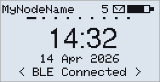

**E-ink (E213 / Wireless Paper / E290):**

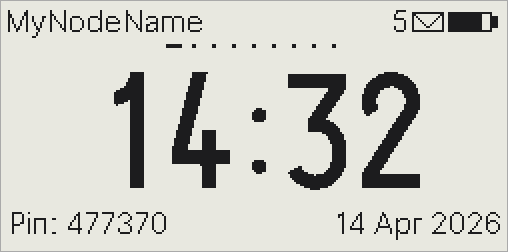

- Node name at top-left, battery at top-right
- **Battery icon**: the fill shows the charge.
  - A lightning bolt while charging *(V3, Wireless Paper, T096)*.
  - A USB plug while Connection Mode is USB and the cable is connected *(Heltec V4, E213, E290, T096; on T096 only once an app has opened the connection)*.
- **Envelope** (`5✉`): unread messages
- **GPS icon**: shown while GPS is on, so you don't forget it *(on OLED only on this page)*
- **Muted icon**: shown while the buzzer is muted *(ProMicro fakeTec with a buzzer)*
- **Radio off icon** (an x beside signal bars): shown while the LoRa radio is off
- Dots below the header: which page you are on
- **Large clock**: local time once the time is set; before that, time since start-up
- **OLED / TFT**: date and connection status at the bottom. In WiFi mode the node's network name replaces the date, e.g. `meshcore-d267.local`.
- **E-ink**: connection status or pairing PIN at the bottom-left, date at the bottom-right. In WiFi mode, before an app connects, the bottom row shows the IP address and the network name, e.g. `192.168.1.83` and `meshcore-d267`.
- **Long press** → **Home menu**. Single click moves down, long press runs the item, double click leaves.
  - **Sync to app**: sends all messages on the node to the connected app again (`Syncing N msgs`), e.g. after reinstalling the app or for a second app over USB or WiFi. Shows `Sync (no app)` when no app is connected.
  - **Save messages**: saves all messages to flash now (`Saved N msgs`), so they survive a power cut or the RESET button.
  - **Delete all messages**: after `Delete all msgs?` → **Yes**, deletes every message on the node, in RAM and in flash. Contacts, channels and settings are kept.
  - **Reboot**: restarts the node.
  - **Shutdown**: turns the node off, the same as **Settings → Shutdown**.

Connection status:
- `< BLE Connected >` — app connected over Bluetooth
- `Pin: 123456` — waiting for Bluetooth pairing; enter this PIN in the app
- `BLE: OFF` — Bluetooth is off
- `< USB >` — USB mode
- `< WiFi Connected >` — app connected over WiFi
- `IP:192.168.1.x` — WiFi mode, waiting for the app to connect (port 5000)
- `WiFi: connecting...` — WiFi mode, not yet connected to the router

> **Finding the node on WiFi**: the IP address can change. The network name `meshcore-xxxx.local` stays the same and can be used instead, on devices that support `.local` names.

> **Time and date**: set your time zone once with `set tz.offset 7` (for UTC+7, or `set tz.offset 5:30` for UTC+5:30, see [TerminalCLI](Companion_TerminalCLI_Commands.md)); the default is UTC. The time comes from the app when it connects, or from GPS.

---

## Chats page

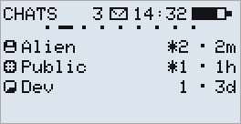

The most recent conversations, newest first: contacts (person icon), channels (`#` icon) and room servers (speech bubble icon), each with its number of messages (`*2` = 2 unread) and the age of the newest one. A channel set to priority `none` shows `blocked`. The header shows the unread count.

Messages stay on the node after your app has synced them, and the messages you send are kept with them. The node keeps up to 256 messages (128 on the HT-CT62); when it is full, the oldest are deleted first. Messages are kept through a restart, an OTA update, **Power off** and the low-battery sleep. On ESP32 boards, a power cut or the RESET button deletes them, unless you used **Save messages** in the Home menu before.

- **Long press** → the full conversation list ([Level 0 — Group list](#level-0--group-list))

---

## Quick Send page

Send a preset message to a channel without typing. It goes to the Public channel unless you pick another in Settings → **Qk.Ch.** (see [Quick Send Channel screen](#quick-send-channel-screen)).

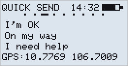

- The bottom line shows your position:
  - `GPS:lat,lon` — GPS has a fix; the position is added to the message
  - `?GPS:lat,lon` — no GPS fix; the last known position is used
  - `GPS: Private` — GPS Privacy is on; no position is added
- **Long press** to choose a preset

**Choosing a preset:**

| Press | Action |
|---|---|
| Single click | Next preset |
| Double click | Back |
| Triple click | Previous preset |
| Long press | Send it → `Sent!` or `Send failed` |

After sending, the display counts the repeaters heard passing your message on (e.g. `Heard 3 Repeats`). The position is added to the text, e.g. `I'm OK @10.7769,106.7009`.

**Change the presets and the channel with [TerminalCLI](Companion_TerminalCLI_Commands.md):**
```
get quick                        list all presets
set quick.0 Arrived at camp      change preset at index 0
set quick.reset                  restore all defaults
get quick.channel                show current target channel
set quick.channel MyGroup        change target channel
```

---

## Quick Send Channel screen

Opened from **Qk.Ch.** in Settings: pick the channel Quick Send sends to.

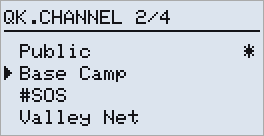

- `*` marks the channel in use

| Press | Action |
|---|---|
| Single click | Move arrow to next channel |
| Double click | Back, nothing changed |
| Triple click | Move arrow to previous channel |
| Long press | Use the selected channel |

---

## Contacts page

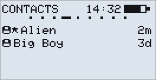

Favourites first, then the contacts heard most recently, with how long ago on the right. **Long press** opens the contact list.

---

## Contact List screen

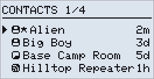

Your contacts, favourites (★) first, then the most recently heard, with how long ago on the right. Contacts are marked with a person icon, room servers with a speech bubble icon, repeaters with a repeater icon, sensors with a pulse trace icon. With Settings → **Contact Display** set to `Favs`, the list is titled **FAVOURITES** and shows only favourites.

When the contact list is full and no app is connected, an alert **Contacts full** shows when a new contact is heard.

| Press | Action |
|---|---|
| Single click | Move arrow to next contact |
| Double click | Return to home |
| Triple click | Move arrow to previous contact |
| Long press | Open action menu for selected contact |

---

## Contact Action screen

Long press on a contact opens its menu:

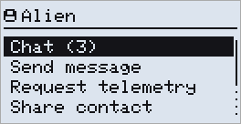

| Press | Action |
|---|---|
| Single click | Move highlight to next item |
| Double click | Return to contact list |
| Triple click | Move highlight to previous item |
| Long press | Run the selected item |

- **Chat (n)** — the conversation with this contact, when there is one (see [Level 1 — Group detail](#level-1--group-detail)). Double click returns to this menu.
- **Send message** — send a direct message (Quick Reply screen)
- **Trace position** — show the contact's position on the [GPS Trace screen](#gps-trace-screen), when the contact shares one
- **Request telemetry** — ask the contact for its battery, sensors and position
- **Request status** — repeaters and room servers only: the same figures as the app's Status page (see [Telemetry Result screen](#telemetry-result-screen))
- **TerminalCLI** — run commands on a repeater, room server, sensor or another person's node, with the CardKB attached (see [TerminalCLI on a repeater or room server](#terminalcli-on-a-repeater-or-room-server) and [TerminalCLI on another node](#terminalcli-on-another-node))
- **Ping (zero hop)** — repeaters only: check that the repeater hears you directly, and how well (see [Path Trace screen](#path-trace-screen))
- **Trace path** — repeaters only: send a trace along repeaters you choose (see [Path Trace screen](#path-trace-screen))
- **Reset path** — shown when the contact has a stored path
- **Share contact** — send the contact on to the nodes that hear you directly: **Contact shared**, or **Share failed** when the node has no advert of the contact stored
- **Permissions** — people only: what this contact may ask of your node (see [Contact permissions](#contact-permissions))
- **Add favourite** / **Remove favourite** — mark the contact as a favourite, or unmark it
- **Remove contact** — delete the contact and its conversation. It asks first, with **No** selected: single click moves between **No** and **Yes**, long press confirms, double click cancels.

A repeater's menu:

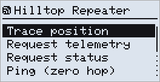

A sensor's menu is the same, without **Request status**, **Ping (zero hop)** or **Trace path**.

### Contact permissions

**Permissions** in a person's menu sets what they may ask of your node, the same switches as the app's Permissions screen for that contact:

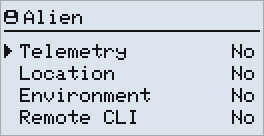

Long press switches the selected line between **No** and **Yes**, double click goes back. Telemetry, Location and Environment count only while Settings → Contacts → **Telemetry** (and **Telem. Loc.**, **Telem. Env.**) are set to `Contacts`.

---

## Telemetry Result screen

Shows what the contact sends back: `VBAT` (its battery), its sensors (`#2`, `#3`...) and its GPS position if it has one.

On a repeater, room server or sensor, `Logging in...` is shown before `Requesting...`. A sensor answers only a node that has logged in to it with its admin password, from the app or with [TerminalCLI](#terminalcli-on-a-repeater-or-room-server); otherwise `Login: no response` is shown.

A login with no reply over the stored path resets the path and is retried once by flood:

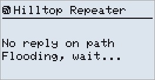

**While waiting:**

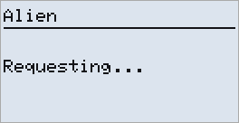

**On success:**

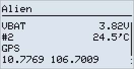

**On timeout:**

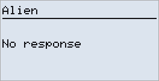

| State | Press | Action |
|---|---|---|
| Waiting | Double click | Cancel request, return to the contact's menu |
| Result | Single click / Triple click | Scroll down / up, if the list is longer than the screen |
| Result | Long press | Open GPS Trace screen *(only when the reply has a GPS position)* |
| Result / Failed | Double click | Return to the contact's menu (single click too, if there is nothing to scroll) |

The position is shown in the format chosen in Settings → **Pos. Format**.

**Request status** uses the same screen:

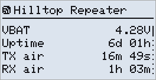

- `VBAT`, `Uptime` — battery and time since the last restart
- `TX air`, `RX air` — total time spent transmitting and receiving
- `RSSI`, `SNR` — signal of the last packet it heard
- `Noise floor` — background noise it hears, in dBm
- `Sent`, `Recv` — packets sent and received, with the `flood` and `direct` counts below
- `Dups fl`, `Dups dr` — flood and direct packets heard more than once
- `Queue` — packets waiting to be sent
- `RX errs` — packets received with errors; `Err flg` — error flags, `0x0000` when there are none

A room server shows `Posted` and `Pushed` (messages posted to the room, and sends of them to members) instead of `RX air` and `RX errs`.

Other results: `Login failed` or `Login: no response` — the repeater, room server or sensor did not let you in, or did not answer; `No response` — the contact did not answer; `Send failed` — the request could not be sent.

---

## Path Trace screen

Opened from **Trace path** in a repeater's menu. The path starts as the route to that repeater, ending at the repeater itself:

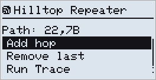

- **Add hop** — pick a repeater from your contacts to add at the end. The code on the right is the one the path uses.
- **Remove last** — remove the last hop
- **Run Trace** — send the trace along the path. You must be able to hear the last repeater directly.
- **Run Round Trip** — send the trace along the path and back the same way: `21,22,7B` goes as `21,22,7B,22,21`.

**Ping (zero hop)** in a repeater's menu sends a trace straight to the repeater and back, with no path to edit. The repeater must be within direct range.

**Result:**

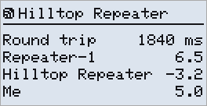

The round-trip time, then the SNR each repeater heard the trace at, then the SNR you heard it at. A repeater that is not in your contacts shows its code. `No response` means the trace did not come back.

| State | Press | Action |
|---|---|---|
| Path | Single click / Triple click | Move highlight to next / previous item |
| Path | Long press | Run the selected item |
| Path | Double click | Return to the repeater's menu |
| Adding a hop | Long press | Add the selected repeater |
| Adding a hop | Double click | Return to the path without adding |
| Waiting | Double click | Cancel |
| Result | Single click / Triple click | Scroll down / up, if the list is longer than the screen |
| Result / Failed | Double click | Return to the path, or to the repeater's menu after a ping (single click too, if there is nothing to scroll) |

---

## Reading messages

Long press on the **Chats** page opens the conversation list. A message counts as read once you have seen it, or once your app has received it.

### New message alert

When new messages arrive, an alert shows which conversations they are in:

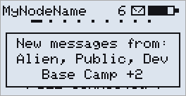

| Press | Action |
|---|---|
| Single click | Open the conversation list |
| Double click | Close the alert; the messages stay unread |

A new message in the conversation you are reading shows there instead, without an alert (see [Level 1 — Group detail](#level-1--group-detail)).

### Level 0 — Group list

Long press on the **Chats** page, or a single click on the new message alert, opens the list of all your conversations.

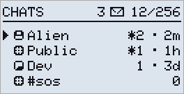

- Newest conversation first; on the right, the number of messages (`*2` = 2 unread) and the age of the newest one
- Top right: the unread count, then messages stored / the most the node keeps
- `#` icon = channel, speech bubble icon = room server, person icon = contact
- A channel set to priority `none` shows `blocked`
- Channels with no messages come after the conversations, with `0`
- **+ Add channel** ends the list (not shown while the app is connected)

| Press | Action |
|---|---|
| Single click | Move arrow to next conversation |
| Double click | Return to home |
| Triple click | Move arrow to previous conversation |
| Long press | Open the conversation; on a channel with no messages, open its [menu](#channel-menu); on **+ Add channel**, [add a channel](#adding-a-channel) |

### Level 1 — Group detail

One conversation, like a chat, oldest message at the top. It opens on the first unread message.

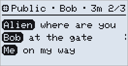

- Each message starts with the sender's name; yours start with **Me**.
- The dashed line on the right marks the selected message; the top row shows who sent it and when.
- When the newest message is on the screen, a new one scrolls into view as it arrives.
- While you read older messages, the top right shows how many newer ones are unread (`▼ 2 new`) instead of the message number.

| Press | Action |
|---|---|
| Single click | Next message (from the newest back to the oldest) |
| Double click | Return to the group list |
| Triple click | Previous message |
| Long press | Open popup menu |

---

## Popup menu (while reading a message)

Long press any message to open the popup:

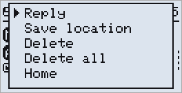

| Press | Action |
|---|---|
| Single click | Move to next item |
| Triple click | Move to previous item |
| Long press | Confirm selected item |
| Double click | Dismiss menu (cancel) |

- **Reply** — reply to the contact, the channel or the room server (everyone in the room sees it)
- **Save location** — save the position in the message, when it has one
- **Join channel** — join the channel of a received [invite](#inviting-to-a-channel)
- **Join #sos** — join the hashtag channel the message names, here `#sos`
- **Delete** — delete this message
- **Delete all** — delete the whole conversation
- **Home** — go to the Home page
- **Share** — show the channel's key (channel messages only, see [Sharing a channel](#sharing-a-channel))
- **Invite** — send the channel to a contact (channel messages only, see [Inviting to a channel](#inviting-to-a-channel))
- **Priority** — the channel's [priority](#channel-priority) (channel messages only)

### Channel priority

Opened from **Priority** in the popup or in the [channel menu](#channel-menu). `*` marks the current priority.

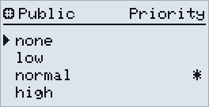

| Priority | Effect |
|---|---|
| `none` | New messages from the channel are ignored: not kept, not sent to the app, no alert. Messages already on the node stay. |
| `low` | Only the last 12 messages are kept (6 on the HT-CT62). |
| `normal` | Default. When the node is full, the oldest channel messages are deleted first. |
| `high` | Never deleted to make room, like direct messages. |

Long press sets the priority, double click goes back without a change. It is the same setting as `set ch.msgs` in [TerminalCLI](Companion_TerminalCLI_Commands.md).

### Confirming a delete

Delete asks first, with **No** selected:

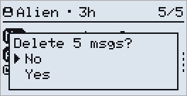

Single click moves between **No** and **Yes**, long press confirms, double click cancels.

> A deleted message is gone for good, also for an app that has not synced it yet.

---

## Channels

### Channel menu

Long press on a channel with no messages in the conversation list opens its menu:

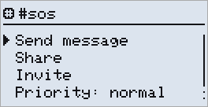

- **Send message** — send to the channel (Quick Reply screen)
- **Share** — show the channel's key (see [Sharing a channel](#sharing-a-channel))
- **Invite** — send the channel to a contact (see [Inviting to a channel](#inviting-to-a-channel))
- **Priority** — the channel's [priority](#channel-priority)
- **Remove channel** — delete the channel. It asks first, with **No** selected. Not shown while the app is connected.

To remove a channel that has messages, delete them first with **Delete all**.

### Adding a channel

**+ Add channel** at the end of the conversation list opens:

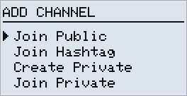

- **Join Public** — add the Public channel back, when it has been removed
- **Join Hashtag** — type the name, e.g. `sos` for `#sos`
- **Create Private** — type a name; the node makes a new key and shows it for [sharing](#sharing-a-channel)
- **Join Private** — type the name, then the 32-character key (spaces allowed)

Join Hashtag, Create Private and Join Private need the [CardKB keyboard](#cardkb-keyboard). Enter adds the channel, Esc goes back.

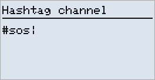

### Sharing a channel

**Share** in the channel menu or in the popup shows the channel's key:

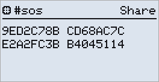

Type it without the spaces into **Join Private** on another node, or **Join a Private Channel** in the app. Any press goes back.

### Inviting to a channel

**Invite** in the channel menu or in the popup lists your contacts. Long press on one sends them the channel as a message: **Sending...**, then **Delivered!** or **Not delivered**.

A received invite reads:

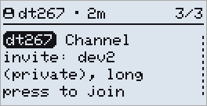

**Join channel** in the popup adds it. The app shows the same invite with an **Add Channel** button.

To share a hashtag channel, write its name in a message, e.g. `meet on #sos`: **Join #sos** in the popup adds it.

**Join channel** and **Join #sos** are not shown while the app is connected.

---

## Quick Reply screen

Reply with a preset, without typing. The presets are the same as on the Quick Send page.

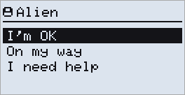

The header shows who it goes to, with its icon: a contact or a channel.

| Press | Action |
|---|---|
| Single click | Next preset |
| Double click | Back without sending |
| Triple click | Previous preset |
| Long press | Send the selected preset |

An alert shows whether it was sent. A reply from a conversation then takes you back to its end, where your reply shows.

---

## CardKB keyboard

An M5Stack Unit CardKB v1.1 on the node's I2C sensor pins (SDA, SCL, 3.3 V, GND) lets you type messages. You can plug it in and out at any time; **Keyboard ready** shows when it is found.

**Navigating.** The keys work together with the button:

| Key | Same as |
|---|---|
| Down | Single click: next item in a list or menu, next message |
| Up | Triple click: previous item, previous message |
| Right / Left | Next / previous Home screen page |
| Left (deeper screens) | Double click (back) |
| Enter | Long press (select / send) |
| Esc | Double click (back) |
| Fn + 1 … 9, Fn + 0 | Jump to that Home page from any screen: 1 Home, 2 Chats, 3 Quick Send, 4 Contacts, 5 Saved Locations, 6 Recent, 7 Radio, then GPS *(when there is one)*, Sensors and Settings |

- **On a Home page**, Up or Down opens the page's list, like Enter. On Sensors they switch between the views.
- **In a list opened from a page**, Right or Left goes to the next or previous page.
- **On other screens**, Left goes back, like Esc.

While the display is off, the first key only turns it on.

**Typing a message.** With the keyboard attached, **Reply** on a message and **Send message** on a contact open the text editor instead of the Quick Reply screen. On an open Quick Reply screen, `>> Type...` at the end of the list opens the editor.

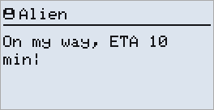

The header shows who it goes to; `|` is the cursor.

| Key | Action |
|---|---|
| Letters, digits, symbols, Space | Insert at the cursor |
| Del | Delete the character before the cursor |
| Left / Right | Move the cursor |
| Up / Down | Jump to the start / end |
| Enter | Send |
| Esc | Leave without sending |

A message can be up to 151 characters; an accented or non-Latin letter counts as 2 or 3. Shift gives capitals and Sym gives symbols; with the [low-power CardKB firmware](https://github.com/dt267/MeshCore-Low-Power-Firmware/releases/download/MeshCore-low-power-v1.17.dev_1011/M5Stack_CardKB_v1.1_low_power.hex), tap Shift or Sym once to lock it and again to unlock. A direct message shows **Sending...**, then **Delivered!** or **Not delivered**. A channel message shows **Sent!**.

### Typing in other languages

Turn the languages on in Settings → [Input Languages](#settings-page). In the message editor, **Tab** switches between English and them, and the header shows the one in use, e.g. `VI`. TerminalCLI, passwords and channel names are always typed in English. On an OLED, set **Message Font** to `Large` to see accents and non-Latin letters while typing.

**Vietnamese** — Telex, as with Unikey on a PC:

| Type | Get |
|---|---|
| `aa` `aw` `ee` `oo` `ow` `uw` `dd` | â ă ê ô ơ ư đ |
| `w`, `[`, `]` | ư, ư, ơ |
| `s` `f` `r` `x` `j` after the word | sắc, huyền, hỏi, ngã, nặng; `z` removes the tone |

The same key twice types it plainly, e.g. `ww` → w.

**Russian, Ukrainian, Belarusian** — the PC layout (ЙЦУКЕН) on the CardKB's letter keys. The letters on keys the CardKB lacks are on Sym:

| Key | Russian | Ukrainian | Belarusian |
|---|---|---|---|
| Sym+e | х (Sym+q Х) | х (Sym+q Х) | х (Sym+q Х) |
| Sym+r | ъ (Sym+w Ъ) | ї (Sym+w Ї) | ' |
| Sym+a | ж (Sym+s Ж) | ж (Sym+s Ж) | ж (Sym+s Ж) |
| Sym+o | э (Sym+p Э) | є (Sym+p Є) | э (Sym+p Э) |
| Sym+d | ё (Sym+i Ё) | ' | ё (Sym+i Ё) |
| Sym+y | | ґ (Sym+u Ґ) | |

`,` and `.` type б and ю (Sym+, and Sym+. for Б and Ю). Punctuation is where the PC has it: `.` Sym+t, `,` Sym+k, `?` Sym+7, `"` Sym+2, `;` Sym+4, `:` Sym+6.

**Kazakh** — the PC layout: the Russian letters, and on the number row:

| Key | 2 | 3 | 4 | 5 | 8 | 9 | 0 | Sym+g | Sym+j | 1 | 6 | 7 |
|---|---|---|---|---|---|---|---|---|---|---|---|---|
| Gets | ә | і | ң | ғ | ү | ұ | қ | ө | һ | " | , | . |

Capitals: Sym+2, 3, 4, 5, 8, 9, 0 and Sym+h, Sym+f. There are no digits, as on the PC; Tab to English for them.

**US-International** — for French, German, Spanish and other Latin-script languages. Type the accent, then the letter:

| Accent | Key | Example |
|---|---|---|
| `'` | Sym+o | `'e` é, `'c` ç |
| `` ` `` | Sym+d | `` `a `` à |
| `"` | Sym+p | `"u` ü |
| `^` | Sym+6 | `^o` ô |
| `~` | Sym+i | `~n` ñ |

The accent then Space types the accent itself, e.g. `'` Space for an apostrophe. Fn works like AltGr on a PC: Fn+s ß, Fn+n ñ, Fn+q ä, Fn+p ö, Fn+y ü, Fn+e é, Fn+, ç.

### TerminalCLI on the node

While the CardKB is attached, the Home menu (long press on the Home page) ends with **TerminalCLI**. It runs the node's own [TerminalCLI commands](Companion_TerminalCLI_Commands.md).

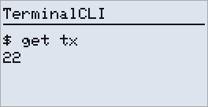

| Key | Action |
|---|---|
| Letters, digits, symbols, Space | Type the command after the `$` prompt |
| Enter | Run it; the reply appears under the command |
| Up / Down (on a reply) | Scroll a long reply |
| Enter (on a reply) | Next page, while `[Enter] more` is shown |
| Any other key (on a reply) | Back to the prompt; typing starts the next command |
| Up (empty prompt) | Bring back the last command |
| Esc (at the prompt) | Back to the Home page |

### TerminalCLI on a repeater or room server

**TerminalCLI** in the menu of a repeater, room server or sensor ([Contact Action screen](#contact-action-screen)) runs commands on it. First enter its admin password:

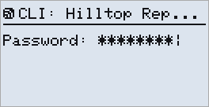

Press Enter to log in. With the admin password, the `$` prompt appears. Otherwise you see one of these and can try again:

- `Logged in as Guest`, `Read-only` or `Read-write`: logged in, but without admin rights
- `Login refused`: the server refused you
- `No reply`: no answer (also after a wrong password)

With no reply over the stored path, the login is retried once by flood (`No reply on path` / `Flooding, wait...`).

Type a command and press Enter: the reply appears under it, or `(no reply)`. Up / Down scroll a long reply; Up on an empty prompt brings back the last command. Esc goes back to the server's menu. The replies are shown only on the node, not in the app. See [Repeater CLI Commands](Repeater_CLI_Commands.md).

### TerminalCLI on another node

**TerminalCLI** in a person's menu runs [Companion commands](Companion_TerminalCLI_Commands.md) on their node. There is no password: the `$` prompt opens at once, and their node answers only if it allows you **Remote CLI** in your contact's [Permissions](#contact-permissions). Otherwise every command ends in `(no reply)`.

---

## Saving a GPS location

On a message with a GPS position, long press and choose **Save location**:

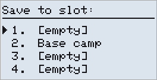

| Press | Action |
|---|---|
| Single click | Move to next slot |
| Triple click | Move to previous slot |
| Long press | Save to selected slot |
| Double click | Cancel |

> **Tip for SOS situations**: save the location right away. It stays on the **Saved Locs** page even after the message is gone.

---

## Saved locations

The **SAVED LOCS** page shows your saved GPS points.

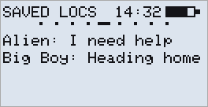

Long press the **SAVED LOCS** page to open the full list:

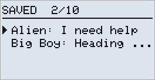

Each entry shows the sender and the start of the message.

| Press | Action |
|---|---|
| Single click | Move arrow to next entry |
| Triple click | Move arrow to previous entry |
| Long press | Open GPS trace screen for the selected entry |
| Double click | Return to home |

---

## GPS Trace screen

Shows live distance and bearing from your current position to a saved location, a contact's advertised position (**Trace position**) or the GPS position in a telemetry reply (**Trace GPS**).

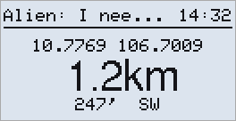

- **Top line**: the target's name and the time
- **Coordinates**: the target's position (format: Settings → **Pos. Format**)
- **Distance**: in a straight line, needs your own GPS fix
- **Bearing**: the direction to go

With a compass attached, an arrow on the left points to the target; distance and bearing move to the right:

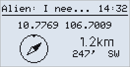

If your node has no GPS fix, only the coordinates are shown.

| Press | Action |
|---|---|
| Any button | Go back |

---

## Recent page

Shows the most recently heard nodes — real adverts, and repeaters found by **Node Discovery**.

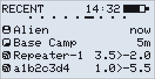

Each row starts with the node's icon, as in the [Contact List screen](#contact-list-screen), and shows how long ago the node was heard. A repeater found by Node Discovery shows the signal strength (SNR) both ways instead: how it heard you, then how you heard it. One that is not in your contacts shows a code instead of a name.

**Long press** opens a menu:

- **Send Zero Hop Advert** — announce yourself to the nodes in direct range (`Advert sent!`). Useful when two people standing together want to find each other at once.
- **Node Discovery** — look for repeaters in range (`Discovering...`); they appear on this page. They are not added to your contacts.

| Press | Action |
|---|---|
| Single click | Next item |
| Double click | Back |
| Triple click | Previous item |
| Long press | Run the item |

---

## Radio page

The radio's settings on one row, then the link and traffic. Long press for the radio settings.

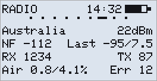

| Field | Meaning |
|---|---|
| First row | The [preset](#radio-preset-screen) in use (`C1: name` for your own), or `freq/bw/sf/cr`, and the TX power |
| NF | Noise floor: background noise in dBm |
| Last | RSSI / SNR of the last packet received |
| RX / TX | Packets received / sent since start-up |
| Air | Share of time transmitting / receiving since start-up, in % |
| Err | Packets received with errors since start-up |

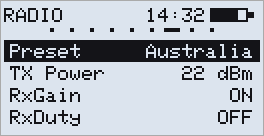

| Press | Action |
|---|---|
| Single click | Next item |
| Double click | Back |
| Triple click | Previous item |
| Long press | Change it |

| Item | Action |
|---|---|
| **Preset** | Opens the [preset list](#radio-preset-screen) |
| **TX Power** | Lowers it 3 dB per long press, then back to the maximum |
| **RxGain** | RX gain: OFF → ON (Heltec V4.3 / T096: OFF → INT → EXT) |
| **RxDuty** | RX duty cycle on/off: lets the receiver sleep between listening windows, saving 2-3 mA at SF8. It runs only with some SF and bandwidth combinations, see [RX Duty Cycle](README.md#rx-duty-cycle); with the others the radio keeps listening all the time. |

All four are also in [Settings](#settings-page).

---

## Radio Preset screen

Opened from Settings → Radio → **Preset**: pick a region's radio settings from the list the MeshCore app offers.

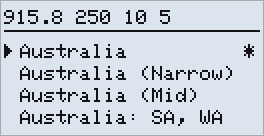

- The header shows the selected preset's frequency, bandwidth, SF and CR
- `*` marks the preset in use
- A preset sets frequency, bandwidth, SF and CR, and for some regions the path hash size. TX power stays as it is.
- Moving to another band takes a moment: the popup says `applying...`
- After the built-in presets come your own, `C1` to `C5`, saved with `set radio.custom.<N>` in [TerminalCLI](Companion_TerminalCLI_Commands.md). Unnamed ones show their values, e.g. `C2: 869.432 62.5 7 5`. An unused slot shows `C3: empty`; a long press on it only shows the command to fill it, the radio stays as it is.

| Press | Action |
|---|---|
| Single click | Move arrow to next preset |
| Double click | Back, nothing changed |
| Triple click | Move arrow to previous preset |
| Long press | Use the selected preset |

---

## GPS page *(optional)*

Only shown when a GPS is found. On E213, V3 and E290, connect the GPS before switching the node on.

**GPS on:**

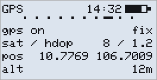

**GPS off:**

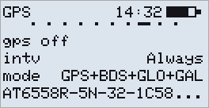

*(mode line: only with a GPS whose satellite systems can be chosen, see below)*

- `fix` / `no fix` — whether GPS has a position
- `sat / hdop` — satellites in use and accuracy (lower HDOP is better); `gps.minsat` / `gps.hdop` in [TerminalCLI Commands](Companion_TerminalCLI_Commands.md) set what counts as a fix
- `intv` — how often GPS updates: `Always`, or every so many seconds (`30s`), minutes (`5m`) or hours (`1h`)
- `mode` — which satellite systems are used
- Bottom line (GPS off) — the GPS chip model
- `pos` — your position (format: Settings → **Pos. Format**)
- `alt` — altitude

Long press for the GPS settings:

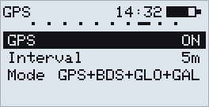

| Item | Long press |
|---|---|
| **GPS** | Turn GPS on or off |
| **Interval** | Pick how long GPS sleeps after each fix: `Always` (never sleeps), `30s`, `1m`, `2m`, `5m`, `10m`, `30m` or `1h`. A value set with `set gps.interval` shows as it is |
| **Mode** | Pick which satellite systems are used. Changed while GPS is on, it applies when you turn GPS off and on again |

**Mode** is shown for the built-in GPS of boards such as Heltec V4 and T096, and for an ATGM336H plugged into the GPS header (E213, V3, E290...). With any other GPS it is hidden, since the module would not take the setting.

Single click goes to the next item, triple click to the previous one, double click goes back. Changes are saved when you go back.

---

## Sensors page

**Battery** first, then one view per sensor; long press switches view. With sensors attached, a scrollbar on the right shows which view you are on.

**Battery — 14-day history:**

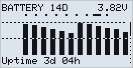

- Battery level over the last 14 days, one bar per day
- Dashed lines: 100% and 50%
- Top right: battery voltage
- Bottom: time since start-up

**Attached sensor readings** *(only shown if an environment sensor is detected)*:

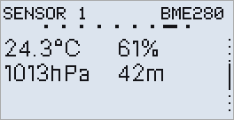

- Top right: the sensor's name (e.g. `BME280`)
- Up to 6 readings, each with its unit (`°C`, `%`, `hPa`...)
- With several sensors, the views are numbered `SENSOR 1`, `SENSOR 2`...

**Compass** *(only shown if an HMC5883L or QMC5883L is detected)*:

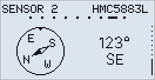

- The notch at the top marks where the device points; the needle points to magnetic north
- Right: the heading in degrees and its direction (`N`, `NE`, `E`...)
- Hold the device level
- `No data` when there is no reading, e.g. with a magnet nearby
- Calibration: Settings → [Compass Calib.](#compass-calibration)

At startup, a **Detected:** alert lists the GPS and the sensors found.

| Press | Action |
|---|---|
| Long press | Next view |

---

## Settings page

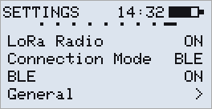

- **Long press** to open the list; groups end with `>`
- In a group, the title shows its name, e.g. `DISPLAY`
- Changes are saved when you leave Settings

| Press | Action |
|---|---|
| Single click | Next item |
| Double click | Back: from a group to the list, from the list to the page |
| Triple click | Previous item |
| Long press | Open the group, or change the item |

**At the top**

| Item | Action |
|---|---|
| **LoRa Radio** | `ON` / `OFF`. Off: nothing is sent or received, and the [radio off icon](#home-page) shows in the header. On again after a restart. |
| **Connection Mode** | Choose `BLE`, `USB` or `WiFi`; the node restarts in that mode. `*` marks the current one. |
| **BLE** | Bluetooth on/off; `ON, Connected` while an app is connected. *Not shown in USB or WiFi mode.* |

**General**

| Item | Action |
|---|---|
| **Qk.Ch.** | The channel Quick Send uses; opens the [channel list](#quick-send-channel-screen) |
| **Buzzer** | `ON` / `MUTED`; it beeps when turned back on *(ProMicro fakeTec with a buzzer)* |
| **Units** | Metric / Imperial |
| **Pos. Format** | How positions are shown: `DD` → `UTM` → `MGRS` |
| **GPS Privacy** | ON: Quick Send messages go without your position |
| **Compass Calib.** | Calibrate the [compass](#compass-calibration) *(when there is one)* |

**Radio**

| Item | Action |
|---|---|
| **Preset** | The preset in use (`C1: name` for your own), or `Custom`; opens the [preset list](#radio-preset-screen) |
| **TX Power** | The radio chip's setting, as `get tx` shows it; opens a list in 3 dB steps down from the board's maximum (e.g. `22`, `19`, `16` …), long press uses one. On boards with a front-end amplifier the antenna gets more than this. |
| **Repeat** | Pass on other nodes' packets, on/off |
| **RxGain** | RX gain: OFF → ON (Heltec V4.3 / T096: OFF → INT → EXT) |
| **RxDuty** | RX duty cycle on/off: lets the receiver sleep, saving 2-3 mA at SF8. Runs only with some SF and bandwidth combinations, see [RX Duty Cycle](README.md#rx-duty-cycle). |

**Display**

| Item | Action |
|---|---|
| **Screen Off** | Screen timeout: `15s` → `3min` → `Never` |
| **Brightness** | Backlight: `25` → `50` → `75` → `100` *(Heltec T096)* |
| **Theme** | `Dark` / `Light`. Dark is the default. *(Heltec T096)* |
| **Flip Screen** | Turn the display upside down |
| **Font Weight** | `Thin` / `Bold` *(e-ink only)* |
| **Message Font** | Message text size: `Normal` / `Large` |
| **Refresh Frequency** | Full refresh after this many screen changes, done once you stop pressing keys: `1` → `5` → `10` → `15` → `30`. `10` is the default. *(e-ink only)* |
| **Clear Ghost** | A deeper clean of a ghosted screen *(e-ink only)* |

**Contacts**

| Item | Action |
|---|---|
| **Contact Display** | `All` / `Favs`: the contact list shows everyone or only favourites |
| **Auto-add** | `All`: add every new contact heard. `Off`: add none. `Custom`: the types chosen in the app or with `contacts.autoadd.types`; long press goes back to `All`. |
| **Telemetry** | Who may request your telemetry: `No` → `Yes` → `Contacts` (those allowed in their [Permissions](#contact-permissions)) |
| **Telem. Loc.** | Whether telemetry includes your location, same three choices |
| **Telem. Env.** | Whether telemetry includes environment sensors, same three choices |

**Input Languages**

| Item | Action |
|---|---|
| **English** | Always on (`Default`) |
| **Belarusian**, **Kazakh**, **Russian**, **Ukrainian**, **US-International**, **Vietnamese** | `ON` / `OFF`: the languages Tab switches between in the [message editor](#typing-in-other-languages) |

**At the bottom**

| Item | Action |
|---|---|
| **Start OTA** | Update the firmware. On ESP32: connect to the WiFi network `MeshCore-OTA` and open `192.168.4.1`; the page also lets you set the WiFi network for WiFi mode. On nRF52 (T096 / RAK4631): use the **nRF Device Firmware Update** app with the `.zip` file. |
| **Shutdown** | Turn the node off |
| **About** | Node name, firmware version and build date |

---

## Compass calibration

Opened from Settings → **Compass Calib.**

Hold the device level and turn it slowly through a full circle. The dial is split into 12 slices, which fill in as you turn through them; the right side shows how many are done and the seconds left.

- When all 12 are done, **Compass calibrated** is shown and you are back in Settings.
- After 30 seconds without all 12, **Calibration failed** is shown.
- Double click cancels.
